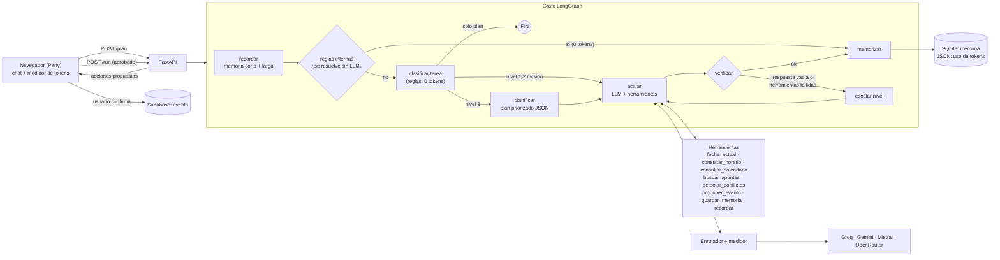

# Party · Agente con enrutamiento inteligente de modelos

Backend del asistente de **Party** (organizador académico para estudiantes). Es un agente construido con
**LangGraph** que integra herramientas de consulta, escritura (con confirmación) y razonamiento, memoria de corto y
largo plazo, planificación, y un **enrutador** que elige qué LLM usar según la tarea, el cupo disponible y la
disponibilidad de cada proveedor. Antes de gastar tokens, el usuario ve qué modelo se usará y decide **Usar / No usar**.

> Evaluación Parcial 2 · ISY0101 Ingeniería de Soluciones con IA.

## 1. Arquitectura



**Flujo en dos pasos (control del gasto):**
1. `POST /plan` clasifica la pregunta y devuelve *qué modelo usaría*, una *estimación* de tokens y cuándo se renueva
   el cupo de ese proveedor. **No llama a ningún modelo** (si una regla basta, responde ahí mismo con "0 tokens").
2. La interfaz muestra la alerta **Usar / No usar**. Solo con **Usar** se llama a `POST /run`, que ejecuta el grafo y
   devuelve la respuesta, el consumo **real** por llamada y las acciones propuestas.

## 2. Estrategia de modelos (`modelos.yaml`)

| Nivel | Para qué | Modelos (editables) |
|---|---|---|
| 0 · Reglas internas | horario, salas, próximas pruebas, fecha | sin LLM |
| 1 · Rápido | preguntas cortas y simples | Llama 3.1 8B (Groq) → Mistral Small |
| 2 · Equilibrado | datos del usuario con herramientas, resumir, redactar | gpt-oss-120b (Groq) → Llama 3.3 70B → Mistral Medium |
| 3 · Razonamiento | organizar, priorizar, comparar, decidir con varias condiciones | Gemini Flash → Magistral → gpt-oss-120b |
| Visión | imágenes | Gemini Flash → OpenRouter |
| Respaldo | última red de seguridad | OpenRouter (modelos gratis) |

**Cómo decide el enrutador** (`router.py`): clasifica con reglas (cero tokens) → toma el nivel → filtra modelos con
clave, sin enfriamiento y con cupo (según límites configurados y, si el proveedor los envía, las cabeceras
`x-ratelimit-*`) → ante un fallo en vivo (429, 5xx, modelo inexistente) pasa al siguiente del nivel, luego a niveles
superiores y por último al respaldo. Si la respuesta viene vacía o todas las herramientas fallan, **escala** de nivel.

> Una tarea que usa herramientas nunca va al nivel 1: los modelos muy chicos fallan al llamar funciones.

## 3. Medidor de tokens honesto

* **Uso propio:** suma de lo que devuelve cada respuesta (siempre disponible).
* **Límite:** el configurado en `modelos.yaml` (se muestra como *configurado*, no como dato oficial).
* **Dato real:** si el proveedor envía cabeceras de límite (p. ej. Groq) se muestra "quedan N (dato del proveedor)".
* Si un proveedor no entrega un dato, **no se inventa**. La estimación previa (≈ 1 token cada 4 caracteres) se rotula
  *aproximada*; los tokens usados se marcan *aprox.* cuando el proveedor no informó el total.
* Cada proveedor declara **si y cuándo renueva** su cupo; los créditos de prueba que no se renuevan quedan fuera.

## 4. Memoria (IE3, IE4)

* **Corto plazo:** últimos turnos por sesión (SQLite), inyectados en cada llamada.
* **Largo plazo:** hechos duraderos ("recuerda que prefiero estudiar de noche", o los que guarda el agente con
  `guardar_memoria`). Se recuperan por relevancia de palabras (BM25 simplificado) y viajan en el prompt.
* **Contexto de datos:** el horario, los eventos y los apuntes **no se pegan en el prompt**: el modelo los consulta con
  herramientas, lo que ahorra tokens y evita inventar datos.
* *Limitación conocida:* la recuperación es léxica. La búsqueda semántica con embeddings (pgvector en Supabase) es el
  siguiente paso y no está implementada.

## 5. Planificación y decisiones adaptativas (IE5, IE7)

* En tareas de nivel 3 un nodo **planificador** genera un plan JSON (`objetivo`, `pasos` con prioridad y herramienta).
* El plan se pasa al ejecutor; si `detectar_conflictos` encuentra un choque de fechas, el agente **ajusta** su propuesta y
  lo explica (p. ej. adelanta la entrega un día porque ya hay una prueba el 24).
* **Escritura con confirmación:** `proponer_evento` no escribe; devuelve una propuesta que el usuario acepta en el chat
  y recién ahí se inserta en Supabase.

### Escenarios para la demostración
1. *"¿Qué tengo mañana?"* → reglas internas, **0 tokens**.
2. *"Dime qué es una clave foránea"* → alerta de uso → nivel 1-2 → respuesta + tokens reales.
3. *"Organiza mi semana: tengo prueba el 24 de octubre y una entrega de informe"* → nivel 3, plan, consulta de
   calendario, detección de conflicto, propuesta de evento, confirmación del usuario.
4. Apagar un proveedor (quitar su clave) → el respaldo responde y el medidor lo refleja.
5. *"Recuerda que prefiero estudiar de noche"* y luego pedir un plan → el recuerdo aparece en la decisión.

## 6. Instalación

```bash
cd agent
# Windows: doble clic en iniciar.bat      Linux/Mac: ./iniciar.sh
# o a mano:
python -m venv .venv && source .venv/bin/activate     # Windows: .venv\Scripts\activate
pip install -r requirements.txt
cp .env.example .env        # y pega tus claves
python -m party_agent.verificar          # valida claves y nombres de modelos (no gasta tokens)
python -m uvicorn party_agent.main:app --port 8787
```

Luego abre `pages/panel.html` → **Chat IA**. Si el agente corre en otra dirección:
`localStorage.setItem("party_agent_url", "http://host:puerto")` en la consola del navegador.

**Claves** (gratis, sin tarjeta): Groq `console.groq.com/keys` · Gemini `aistudio.google.com/apikey` ·
Mistral `console.mistral.ai/api-keys` · OpenRouter `openrouter.ai/keys`.
Con una sola clave ya funciona; cada una adicional suma respaldo. **El `.env` nunca se sube a GitHub.**

Si `verificar` marca un modelo con ⚠️, abre `http://localhost:8787/modelos-disponibles` y corrige el nombre en
`modelos.yaml`. Los catálogos gratuitos cambian con frecuencia.

## 7. API

| Método | Ruta | Descripción |
|---|---|---|
| POST | `/plan` | Clasifica, elige modelo y estima tokens (no gasta tokens) |
| POST | `/run` | Ejecuta el plan aprobado (`aprobado: false` lo cancela sin gastar) |
| GET | `/uso` | Medidor por proveedor y ventana |
| GET | `/modelos` · `/modelos-disponibles` | Configuración y validación de claves/modelos |
| GET | `/health` | Estado |

## 8. Pruebas

`python -m pytest tests` ejecuta 10 pruebas contra un proveedor **simulado** compatible con OpenAI (sin claves ni
internet): reglas sin tokens, plan sin gasto, registro de tokens y cabeceras reales, tarea pesada con plan +
herramientas + ajuste por conflicto, respaldo ante 429, escalamiento, ausencia de claves, cupo configurado, memoria
corta/larga y el ciclo `/plan` → `/run` → cancelar.

> Las pruebas validan la **lógica**. La integración con los proveedores reales debe comprobarse con tus claves
> (`python -m party_agent.verificar`).

## 9. Decisiones de diseño (IE9)

| Decisión | Justificación |
|---|---|
| LangGraph | El flujo tiene ramas, bucles (escalamiento, herramientas) y estado compartido; un grafo explícito es auditable y se dibuja tal cual. |
| API compatible con OpenAI para todos los proveedores | Un solo cliente HTTP cubre todos; cambiar de proveedor es editar YAML. |
| Reglas antes que LLM | Consultas conocidas no necesitan IA: cero costo, cero latencia, y la app sigue útil si se agotan las cuotas. |
| Plan/ejecución separados | Permite pedir permiso y mostrar la estimación sin gastar tokens. |
| Herramientas de escritura solo proponen | Evita que el modelo modifique datos sin consentimiento. |
| Claves en el servidor | Las claves no pueden estar en JavaScript público. |
| Datos del usuario por herramientas | Menos tokens y menos alucinaciones que pegar todo en el prompt. |

## 10. Límites actuales
* Autenticación del agente: no tiene (uso local/demostración); CORS abierto. Para producción: validar el JWT de Supabase.
* Los datos (horario, eventos, apuntes) los envía el navegador; el servidor no consulta Supabase directamente.
* La estimación de tokens previa es aproximada; el historial de uso se guarda en un archivo local.
* Recuperación semántica con embeddings: pendiente.

## 11. Uso de IA en el desarrollo
Este proyecto se desarrolló con apoyo de un asistente de IA para generar y revisar código. Las decisiones de diseño y
la validación son del equipo; **declara esto en el informe** y redacta tus conclusiones sin apoyo de IA, como exige la pauta.

## Orquestación con CrewAI (IL2.3)

Además del grafo (LangGraph), el agente puede responder con un **equipo de 3 agentes** como en los ejemplos del curso
(`3-multiagent_crewai_full.py` y `4-multiagent_crewai_hierarchical.py`):

| Modo | Proceso CrewAI | Quién decide el orden | Tokens |
|---|---|---|---|
| `grafo` | LangGraph (1 agente + herramientas) | el programador | bajo |
| `serial` | `Process.sequential` con `context=[...]` | el programador | medio |
| `jerarquico` | `Process.hierarchical` + `manager_llm` | el Manager (LLM) | medio-alto |

Agentes: **Investigador Académico** (herramientas de consulta), **Planificador de Estudio** (prioriza y detecta choques) y
**Asistente Party** (responde y propone eventos). Las reglas internas (0 tokens) y la memoria siempre corren antes.
Las herramientas se generan como `BaseTool` desde `tools.ESQUEMAS` (una sola fuente de verdad). La fecha se inyecta con
`inputs` porque una herramienta sin parámetros rompe el JSON schema en CrewAI (nota del curso).
Se elige en el chat ("Orquestación de la IA") o con `"orquestacion": "serial" | "jerarquico"` en `/plan`.
Instalar: `pip install -r requirements.txt` (agrega `crewai`).
