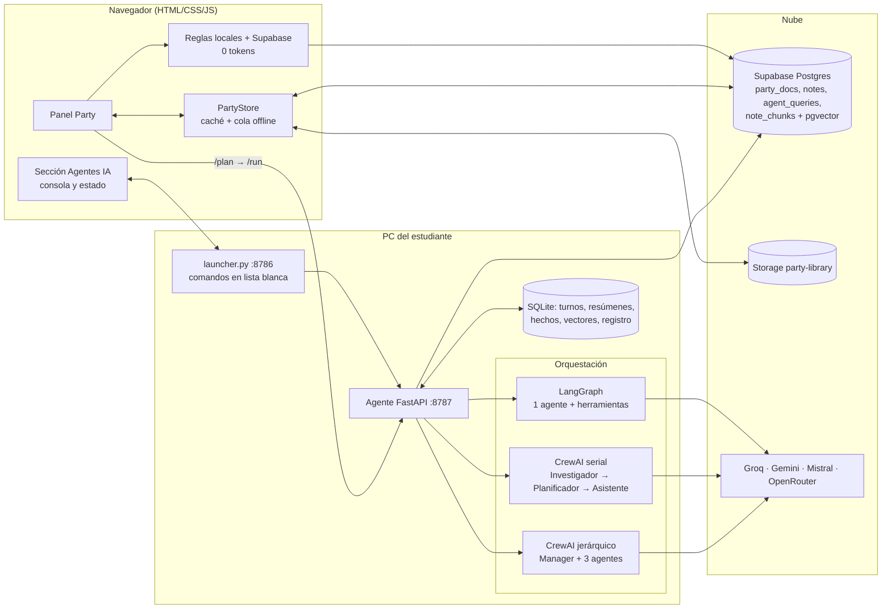

# Arquitectura y justificación de componentes (IE8 · IE9)

## 1. Vista general

**Flujo de una pregunta.** (1) El navegador intenta responder con reglas y datos de Supabase (0 tokens, se anota como `reglas_cliente`). (2) Si no alcanza, pide un **plan** al agente (`/plan`, 0 tokens: estima costo y muestra qué modelo usaría) y el estudiante confirma. (3) `/run` ejecuta: memoria → reglas del agente → clasificación → orquestación elegida (grafo, serial o jerárquico) → verificación → memoria. (4) Cada consulta queda registrada (`reglas`, `reglas_cliente`, `llm`, `sin_cupo`, `cancelado`) para calcular el **% de consultas sin tokens**.

## 2. Mapa de los indicadores

| IE | Qué se muestra | Dónde |
|---|---|---|
| IE1 Herramientas | 9 herramientas (horario, calendario, apuntes, material, conflictos, memoria, propuesta de evento…) con esquema y descripción por argumento | `agent/party_agent/tools.py` |
| IE2 / IE5 Orquestación | LangGraph + CrewAI serial y jerárquico, seleccionables en el chat | `graph.py`, `equipo.py` |
| IE3 Memoria | buffer, ventana, resumen (LLM + respaldo extractivo) y hechos de largo plazo | `memoria.py`, `graph.py` |
| IE4 Recuperación semántica | embeddings `gemini-embedding-001` (768), umbral de similitud, índice vectorial local y pgvector en Supabase | `semantico.py`, `sql/party_migracion_1.sql` |
| IE6 Informe | esqueleto en `docs/notas_informe.md` | — |
| IE7 Eficiencia | % de consultas sin tokens + tokens por pregunta con modelo (`/estadisticas`, tarjeta en «Agentes IA», tabla `agent_queries`) | `registro.py` |
| IE8 Arquitectura | este documento (diagrama) | `docs/` |
| IE9 Justificación | sección 3 | `docs/` |
| IE10 Demostración | sección «Agentes IA»: conectar, ver consola, ejecutar `verificar` / `probar` | `launcher.py`, `panel_agentes_ia.js` |

## 3. Justificación de componentes

| Decisión | Alternativas | Por qué se eligió | Costo / límite asumido |
|---|---|---|---|
| **Reglas primero (0 tokens)** | Llamar siempre al LLM | Horario, calendario y tareas se responden exacto con datos propios; el plan gratuito tiene cupos bajos | Hay que mantener el vocabulario de reglas |
| **Dos pasos plan → ejecutar** | Ejecutar directo | El estudiante ve estimación de tokens y modelo antes de gastar cupo | Un clic extra |
| **LangGraph para el flujo normal** | Solo CrewAI | Grafo explícito y trazable (recordar → reglas → clasificar → actuar → verificar); 1 llamada barata en la mayoría de los casos | Menos «colaborativo» |
| **CrewAI serial y jerárquico** | Un solo agente | Es el material del curso; permite comparar costo y calidad (serial ×2–3 tokens, jerárquico ×3–5 respecto de un agente) | Mayor consumo; se usa solo en tareas complejas |
| **4 proveedores con respaldo** (Groq, Gemini, Mistral, OpenRouter) y niveles rápido / equilibrado / razonamiento | Un único proveedor | Si uno agota cupo o falla, el siguiente responde; modelo pequeño para clasificar, grande solo cuando hace falta | Más claves que administrar |
| **Protocolo OpenAI-compatible** | SDK por proveedor | Un solo cliente para todos; CrewAI lo usa con `openai/<modelo>` | Algunas funciones propias del proveedor quedan fuera |
| **Memoria resumen + ventana + largo plazo** | Historial completo | Controla el contexto (tokens) sin perder lo importante | Resumen puede omitir detalles |
| **Embeddings Gemini 768 + pgvector** | Búsqueda por palabras; FAISS local | Entiende sinónimos; pgvector vive junto a las notas en Supabase; 768 dim. es suficiente y liviano | Depende de cupo de embeddings (hay respaldo local por hash) |
| **Supabase (Postgres + Storage)** | Firebase, archivos locales | Ya contiene el proyecto; SQL, pgvector y archivos en un solo servicio | Políticas abiertas en modo demo (ver sección 5) |
| **PartyStore (caché + cola)** | Escribir solo en la nube | La app responde al instante y no pierde datos si se cae la red; al volver se sincroniza | Conflictos se resuelven por «última escritura» |
| **Lanzador local (`launcher.py`)** | Terminal manual | Un navegador no puede abrir programas; el lanzador permite conectar/desconectar y ver la consola desde la web | Un proceso más; solo comandos en lista blanca |
| **FastAPI** | Flask | Asíncrono, validación con Pydantic, documentación automática | — |

## 4. Medidas de eficiencia de tokens
Reglas en navegador y en el agente; estimación previa; `max_tokens` acotado por rol; `max_iter=3`; herramientas que devuelven datos recortados; resumen de turnos antiguos con el modelo más barato; embeddings cacheados por hash de texto (no se vuelve a pagar por texto ya indexado); cooldown de proveedores que fallan.

## 5. Seguridad y límites conocidos
- El lanzador escucha solo en 127.0.0.1 y acepta una lista cerrada de comandos; no hay terminal libre.
- Las claves de los proveedores viven en `agent/.env` (no se sube ni se incluye en el zip).
- **Pendiente post-evaluación:** hoy Party usa su propio login y la clave pública de Supabase con políticas abiertas (`demo_all`); la siguiente etapa es Supabase Auth (Google) + RLS por estudiante.
